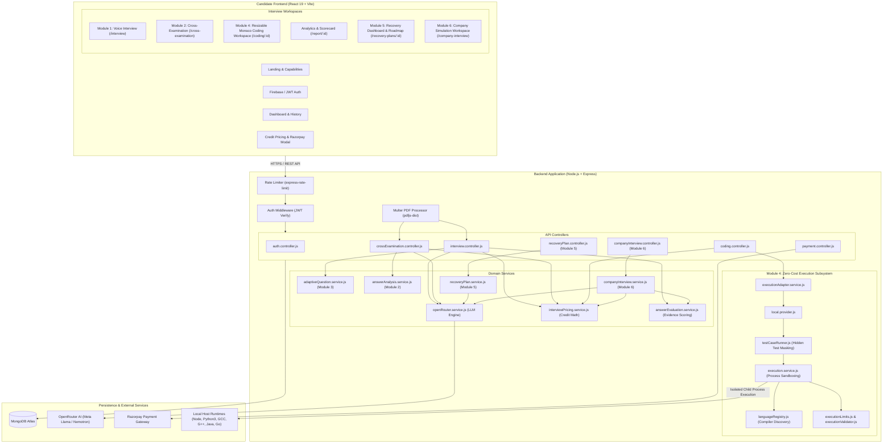
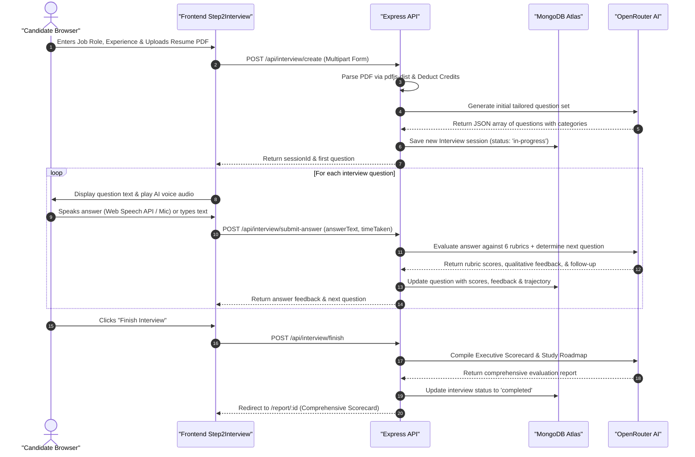
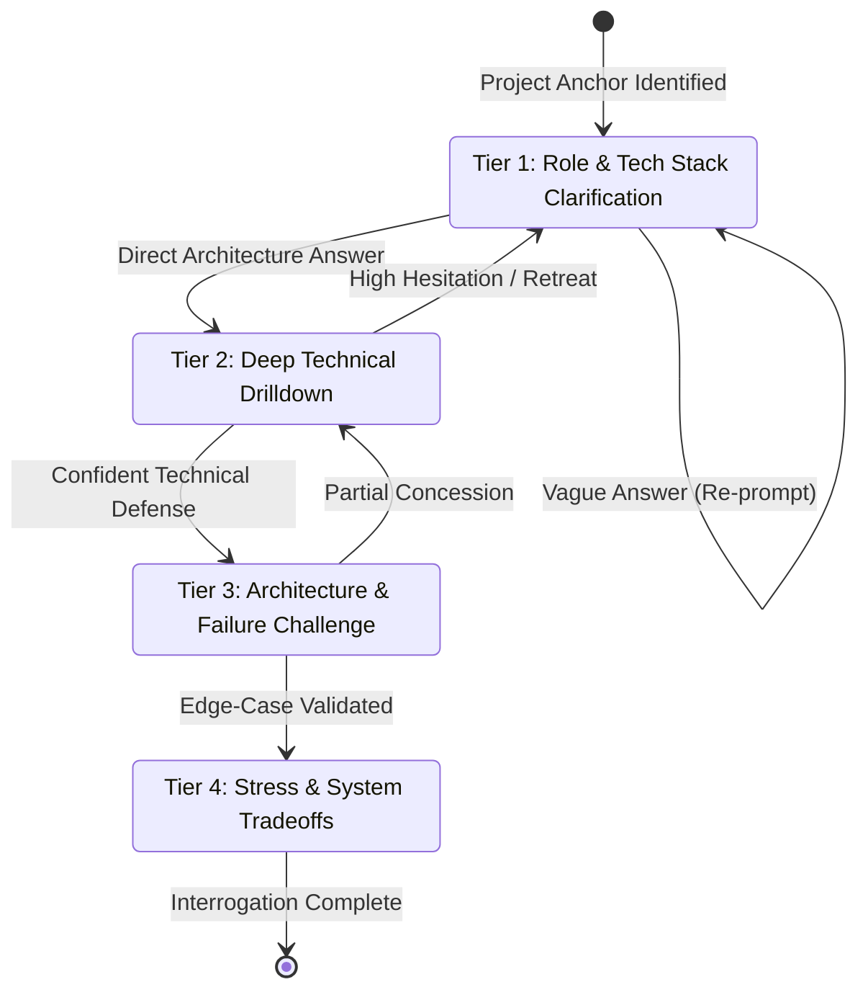
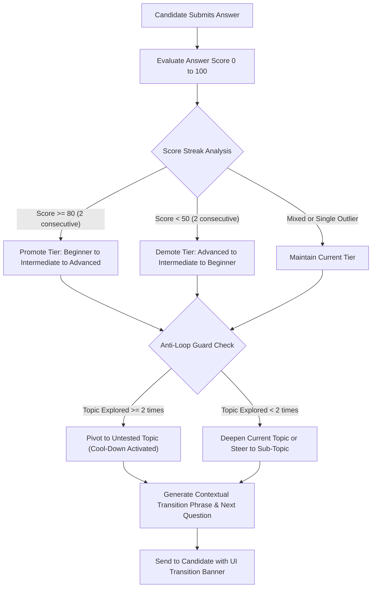
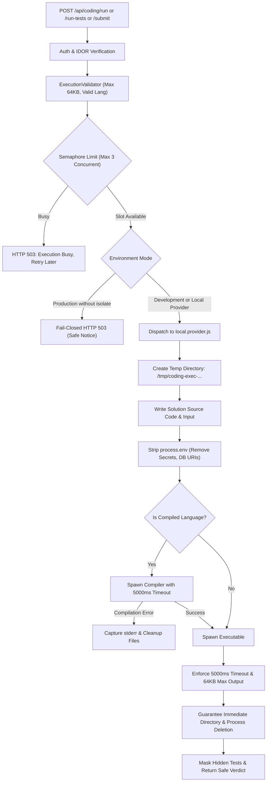
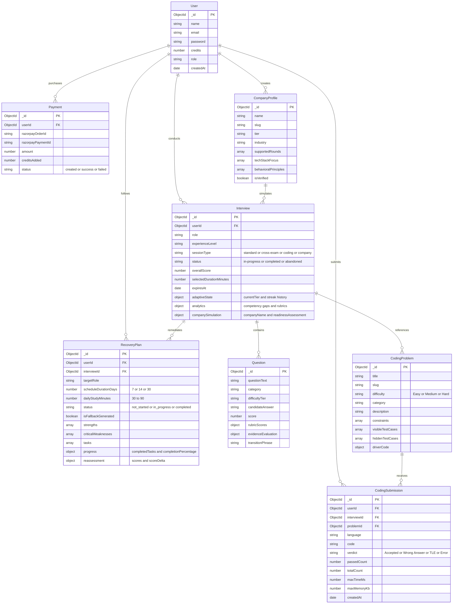

# 🤖 Prepper AI — Enterprise Full-Stack AI Technical Interview Platform

<p align="center">
  
  
  
  
  
  
  
  
</p>

---

## 🌟 Executive Summary

**Prepper AI** is an enterprise-grade, full-stack AI technical interview preparation and candidate evaluation platform built with the MERN stack (MongoDB, Express, React, Node.js). It simulates high-stakes technical, behavioral, project-defense, and live coding interviews with human-caliber AI feedback, real-time code execution, dynamic difficulty steering, and evidence-grounded performance analytics.

The platform is designed around five tightly integrated core modules:
1. **Module 1 — Conversational Mock Interview Engine**: Audio/speech-driven conceptual interviews based on candidate resumes and job roles with 6-criterion rubric scoring.
2. **Module 2 — Dedicated Cross-Examination & Deep-Dive Probing**: Targeted resume project defense engine with progressive escalation, claim verification, and hallucination-resistant transcript grounding.
3. **Module 3 — Adaptive Questioning & Real-Time Steering**: Dynamic difficulty adjustment (Beginner $\leftrightarrow$ Intermediate $\leftrightarrow$ Advanced) with streak-based state transitions, weak-area detection, and Section F Trajectory reporting.
4. **Module 4 — Isolated Live Coding Execution Engine & Workspace**: A zero-cost (₹0 infrastructure), in-backend multi-language code execution engine with Monaco Editor, dynamic host compiler registry, ephemeral process sandboxing, hidden test case protection, concurrency limits, and a fully resizable dual-splitter workspace.
5. **Module 5 — Personalized Interview Recovery Plan**: Transforms multi-source evaluation evidence into adaptive, day-by-day remediation curricula (7, 14, or 30-day schedules) with study time budgets, progress tracking, candidate notes, deterministic fallback, and authentic score-delta reassessment.
6. **Module 6 — Company-Specific Interview Simulation**: Simulates authentic interviews for premier enterprises (Google, Microsoft, Amazon, Adobe, IBM, TCS, Infosys, Accenture, Deloitte) and candidate-supplied companies across 7 distinct rounds (OA, Tech 1, Tech 2, System Design, Hiring Manager, Behavioral, HR) with Role Readiness Scorecards, Hiring Verdicts, and Module 5 remediation bridges.

---

## 🏗️ High-Level System Architecture

Prepper AI integrates a responsive React single-page application with an Express REST API backend, MongoDB persistence, OpenRouter AI intelligence, and a sandboxed host-level child-process execution engine.




---

## 🛠️ Complete Technology Stack

| Layer | Technology | Version | Purpose & Architectural Role |
| :--- | :--- | :--- | :--- |
| **Frontend Framework** | **React** | `^19.0.0` | Declarative UI, component lifecycle, hooks, context |
| **Build Tool** | **Vite** | `^7.3.1` | Ultra-fast HMR, Rollup production bundling, asset optimization |
| **Styling** | **Tailwind CSS** | `^3.4.17` | Utility-first responsive design, dark-mode styling, fluid layouts |
| **Animations** | **Framer Motion** | `^12.4.7` | Smooth transitions, modal overlays, progress bars, interactive cards |
| **Code Editor** | **Monaco Editor** | `@monaco-editor/react ^4.7.0` | VS Code-powered syntax highlighting, auto-indent, code formatting |
| **Charts & Gauges** | **Recharts & Circular Progressbar** | `^2.15.1` / `^2.1.0` | Visualizing category mastery, difficulty trajectories, score meters |
| **State Management** | **Redux Toolkit** | `^2.5.1` | Global auth, user credits, interview sessions, modal states |
| **HTTP Client** | **Axios** | `^1.7.9` | Interceptor-managed API calls with cookie authentication |
| **Backend Runtime** | **Node.js** | `v18+` / `v20+` | Asynchronous event-driven JavaScript server runtime |
| **Web Framework** | **Express.js** | `^4.21.2` | RESTful routing, middleware pipeline, error management |
| **Database** | **MongoDB Atlas** | `v7.0+` | NoSQL document database, ACID transactions, complex aggregations |
| **ODM** | **Mongoose** | `^8.10.1` | Strict schema validation, pre/post hooks, virtual fields |
| **AI Orchestration** | **OpenRouter API** | — | Meta Llama 3.3 70B, Nvidia Nemotron, fault-tolerant retry workflows |
| **PDF Processing** | **`pdfjs-dist` & Multer** | `^4.10.38` / `^1.4.5` | In-memory resume text extraction without disk pollution |
| **Payment Gateway** | **Razorpay Node SDK** | `^2.9.5` | Webhook verification, order creation, dynamic credit wallet reloads |
| **Security & Sandbox**| **Child Process (`child_process.spawn`)** | Built-in | Ephemeral compilation, execution timeouts, memory caps, secret masking |

---

## 🎯 Deep Dive: Module 1 — Conversational Mock Interview Engine

### 1.1 Overview & Objective
Module 1 delivers an authentic, conversational voice- and text-driven technical interview simulation tailored to the candidate's target job role, experience level, and resume projects. It replicates the initial technical screening and behavioral assessment conducted by engineering leads.

### 1.2 Resume Processing Pipeline
When a candidate uploads a PDF resume:
1. **In-Memory Streaming**: Multer intercepts the multipart upload into a memory buffer without persisting sensitive files to the filesystem.
2. **Deterministic Text Extraction**: `pdfjs-dist` parses the PDF document page-by-page, extracting raw textual content, headers, projects, technologies, and work history.
3. **Entity & Role Normalization**: The backend extracts key skills, tech stacks, and domain expertise to calibrate question generation.

### 1.3 6-Criterion Evaluation Matrix
Every candidate answer is evaluated across 6 weighted rubrics:

| Metric | Description | Weight |
| :--- | :--- | :---: |
| **Technical Accuracy** | Factual correctness, proper API/concept naming, and conceptual precision. | 25% |
| **Completeness** | Depth of coverage, edge case consideration, and answering all question facets. | 20% |
| **Structure & Clarity** | Use of logical frameworks (STAR, PREP, top-down structure) and readability. | 15% |
| **Problem-Solving** | Systematic thinking, engineering trade-offs, and design rationale. | 15% |
| **Communication Quality** | Conciseness, tone, professional vocabulary, and confidence indicators. | 15% |
| **Behavioral Alignment** | Ownership, collaboration, conflict resolution, and leadership principles. | 10% |

### 1.4 Module 1 Interview Sequence Flow



---

## 🔍 Deep Dive: Module 2 — Dedicated Cross-Examination & Deep-Dive Probing

### 2.1 Overview & Architectural Separation
Module 2 is an independent, high-pressure interrogation module designed to verify candidate authenticity and test deep architectural understanding. While Module 1 assesses general knowledge, Module 2 specifically probes claimed achievements, project architectures, and metrics listed on the candidate's resume.

- **Dedicated Routing**: Fully decoupled into `/cross-examination` and `/cross-examination/:sessionId`, distinct from the standard `/interview` route.
- **Dedicated History Tracking**: Candidates can view their dedicated Cross-Examination records separately from standard interviews in the dashboard.

### 2.2 Project Opportunity Extraction
1. **Claim Harvesting**: Scans the candidate resume for quantifiable metrics (e.g. *"reduced latency by 40%"*, *"handled 1M requests/day"*).
2. **Anchor Project Selection**: Focuses on the most complex claimed project to construct a high-context interrogation persona.
3. **Plausibility & Trap Generation**: Constructs targeted architectural questions to check if the candidate genuinely built the system or merely listed buzzwords.

### 2.3 Progressive Pressure Escalation Ladder
The cross-examination engine escalates questioning through four distinct pressure tiers based on candidate responses:



### 2.4 Hallucination-Resistant Transcript Grounding
To prevent AI hallucination during intense cross-examination, the evaluation engine enforces **transcript substring grounding**:
- Every identified strength, technical gap, or inconsistency must cite verbatim substrings from the candidate's actual answers.
- Any critique without direct textual evidence is pruned during schema sanitization.

---

## ⚡ Deep Dive: Module 3 — Adaptive Questioning & Real-Time Steering Engine

### 3.1 Dynamic Difficulty Tiers
Rather than delivering a static, predetermined list of questions, Prepper AI continuously evaluates candidate mastery after each answer and dynamically recalibrates the interview trajectory across three difficulty tiers:

- **Beginner**: Foundational definitions, syntax, basic APIs, core patterns.
- **Intermediate**: Real-world application, failure modes, trade-offs, standard architecture.
- **Advanced**: Internal runtimes, concurrency hazards, distributed failure recovery, high-scale optimization.

### 3.2 Streak Rules & State Transition Mechanics
The difficulty engine (`adaptiveQuestion.service.js`) tracks consecutive score streaks:
- **Promotion Threshold**: Two consecutive scores $\ge 80$ automatically elevate the interview to the next difficulty tier.
- **Demotion Threshold**: Two consecutive scores $< 50$ lower the difficulty to provide scaffolded support and isolate specific knowledge gaps.
- **Maintenance**: Mixed scores ($50 \le \text{Score} < 80$) sustain the current difficulty level while exploring adjacent technical domains.



### 3.3 Contextual Transition Phrases
To make steering feel human and natural, the engine selects context-aware transition banners that display live in the candidate's UI:
- *Level Up*: "Excellent depth on system boundaries! Let's elevate the challenge with an advanced architectural scenario."
- *Scaffold Down*: "Let's pause and solidify the fundamental mechanics before moving to complex scaling scenarios."
- *Pivot Topic*: "You've demonstrated consistent mastery here. Let's switch gears and explore concurrency and state synchronization."

### 3.4 Grounded Topic Mastery & Section F Trajectory Report
At the conclusion of the interview, the report generates **Section F: Adaptive Trajectory & Competency Insights**:
- Visual question-by-question progression graph showing difficulty changes.
- Topic mastery radar and weakness heat-map.
- Full interviewer steering decision audit trail detailing why each question was selected.

---

## 💻 Deep Dive: Module 4 — Secure Isolated Live Coding Execution Engine

### 4.1 Zero-Budget Architecture Constraint
Module 4 was engineered under strict zero-cost constraints (₹0 infrastructure budget):
- **No Docker containers** required in production.
- **No virtual machines (VMs)**.
- **No external paid execution APIs** (such as Judge0 cloud or RapidAPI).
- **No separate microservices, Redis, or PostgreSQL instances**.
- Everything runs seamlessly inside the existing Node.js + Express backend and host environment!

### 4.2 Dynamic Language Registry & Discovery
The backend dynamically checks host executable availability on startup (`languageRegistry.js`):

| Language | Target Runtime | Command / Compiler Discovery | Sandboxed Execution File |
| :--- | :--- | :--- | :--- |
| **JavaScript** | Node.js | `node -v` | `solution.js` |
| **Python** | Python 3 | `python --version` or `python3 --version` | `solution.py` |
| **C++** | GCC (G++) | `g++ --version` | `solution.cpp` $\rightarrow$ `solution.exe` / `solution.out` |
| **C** | GCC | `gcc --version` | `solution.c` $\rightarrow$ `solution.exe` / `solution.out` |
| **Java** | OpenJDK | `javac -version` & `java -version` | `Main.java` $\rightarrow$ `Main.class` |
| **TypeScript**| ts-node | `ts-node -v` | `solution.ts` |
| **Go** | Go Compiler | `go version` | `solution.go` $\rightarrow$ `solution.exe` |

### 4.3 Pluggable Provider Architecture & Fail-Closed Security
Execution requests are routed through a provider abstraction (`executionAdapter.service.js`):
1. **Local Provider (`local.provider.js`)**: Executes code on locally verified compilers in development.
2. **Go-Judge / Piston Providers**: Ready for external workers if infrastructure becomes available.
3. **Fail-Closed Production Guard**: In production, unverified or insecure local execution is strictly prohibited. If an execution backend is not safely provisioned, the endpoint fails closed with a controlled `HTTP 503 Service Unavailable`, masking all internal errors and keeping Monaco Editor functional for offline editing.



### 4.4 Ephemeral Sandboxing & Security Boundaries
Every code submission is isolated using defense-in-depth principles:
- **Environment Sanitization**: Host `process.env` is stripped; sensitive tokens (MongoDB URIs, JWT secrets, Razorpay keys) are completely removed from child process environments.
- **Filesystem Isolation**: Code runs inside an ephemeral, uniquely generated temporary directory (`crypto.randomUUID()`) that is automatically erased in a `finally` block even if the execution crashes.
- **Resource Limits**:
  - **Execution Timeout**: Hard kill after `5000ms` via `tree-kill` or process tree termination.
  - **Output Cap**: Standard output and error streams are truncated at `64KB` (`MAX_OUTPUT_BYTES`) to prevent memory flood attacks.
  - **Memory Limits**: V8 JavaScript execution enforces `--max-old-space-size=256` to kill memory bombs.
- **Hidden Test Case Masking**: Visible sample test cases show inputs and expected outputs. Hidden benchmark test cases evaluate strictly server-side; candidate responses only receive pass/fail counts and verdicts (`Accepted`, `Wrong Answer`, `Time Limit Exceeded`, `Memory Limit Exceeded`), preventing test case leakage.

### 4.5 Resizable Monaco Coding Workspace
The frontend coding interface (`CodingWorkspace.jsx`) includes dynamic candidate layout controls:
- **Horizontal Draggable Splitter**: Move between Problem Description and Editor with real-time percentage snapping.
- **Vertical Draggable Splitter**: Resize between Monaco Editor and the Bottom Console Drawer.
- **One-Click Drawer Collapse**: Fold the console down to 42px for unobstructed coding.
- **Double-Click Reset**: Instant reset of dimensions to default proportions.
- **`localStorage` Persistence**: Retains layout configurations across reloads.
- **Transparent Drag Shield**: Prevents Monaco's iframe/canvas layer from capturing mouse events during drag.
- **3 Execution Modes**:
  1. *Run Code*: Executes against arbitrary candidate `stdin`.
  2. *Run Sample Tests*: Tests code against visible example test cases.
  3. *Submit Solution*: Evaluates all test cases (visible + hidden) and persists official submission record to MongoDB.

---

## 📈 Deep Dive: Module 5 — Personalized Interview Recovery Plan

### 5.1 Overview & Objective
Module 5 closes the loop on candidate interview preparation by transforming multi-source evaluation results into an evidence-grounded, day-by-day recovery curriculum. Candidates no longer receive static scorecards; instead, Prepper AI extracts verifiable knowledge gaps and constructs an adaptive study roadmap with progress tracking, candidate notes, and authentic score-delta reassessment.

### 5.2 Multi-Source Evidence Harvesting
The evidence engine (`evidenceHarvester.service.js`) crawls all three evaluation engines without assuming all three exist for every candidate:
1. **Standard Voice/Text Interviews**:
   - `questions[].evidenceEvaluation`: Missing technical concepts, criterion rubric scores, and identified weaknesses.
   - `adaptiveState.identifiedKnowledgeGaps`: Explicit topic knowledge gaps, severities, and misconception quotes.
   - `adaptiveState.identifiedStrengths`: Demonstrable competencies and verified proficiency levels.
2. **Cross-Examination Probing**:
   - `CrossExaminationSession.report.preparationGaps`: Project architecture contradictions and unverified claims.
   - `report.demonstratedStrengths`: Defended claims and architectural tradeoffs.
3. **Live Coding Executions**:
   - `CodingSubmission.verdict`: Test case failure rates, TLEs, runtime errors.
   - `CodingSubmission.evaluation`: Algorithmic flaws, time/space complexity deficiencies, and optimization suggestions.

### 5.3 Evidence Traceability & Anti-Hallucination
Every generated task, weakness, and strength is traceable back to genuine interview records via `evidenceTraceSchema`:
- `sourceType`: `'standard_interview' | 'cross_examination' | 'coding_interview'`
- `sourceId`: MongoDB ObjectId of the source document
- `questionOrProblemId`: Specific question index or problem slug
- `competency`: Specific technical topic or criterion
- `evidenceExcerpt`: Verbatim excerpt or failure verdict

### 5.4 Adaptive Scheduling & Prerequisite Ordering
- **Durations Supported**: 7-Day Sprint, 14-Day Balanced, 30-Day Mastery.
- **Daily Study Time**: 30, 45, 60, or 90 minutes per day.
- **Strict Pedagogical Sequencing**:
  - *Days 1 to Math.floor(Days * 0.35)*: Core theory, misconception resolution, and fundamentals.
  - *Middle Days*: Hands-on coding drills, edge-case hardening, and algorithmic practice.
  - *Later Days*: System design, architectural tradeoffs, and claim defense.
  - *Final Days*: Timed mock drills and comprehensive reassessment readiness.

### 5.5 Deterministic Fallback & Zero-Cost Guardrails
- **₹0 Infrastructure Overhead**: Operates entirely within the existing Node.js + Express backend and MongoDB database.
- **Zero New Credit Charges**: Generating recovery plans is included with interview evaluation without credit deductions.
- **Deterministic Fallback Engine (`recoveryPlanFallback.js`)**: If OpenRouter times out or daily free quota is exceeded, the system deterministically constructs an evidence-grounded study roadmap directly from verified knowledge gaps, guaranteeing zero application downtime or hallucination.

### 5.6 Reassessment Integrity & Score Comparison Delta
- **Comparable Rubrics**: Reassessment evaluates candidate answers on the identical 0-100 rubric scale.
- **Measured Delta**: Computes $\Delta = \text{Reassessment Score} - \text{Original Baseline Score}$.
- **Evidence Separation**: Stores original and reassessment findings in separate fields, recording observed improvements and remaining gaps.

---

## 🏢 Deep Dive: Module 6 — Company-Specific Interview Simulation Engine

### 6.1 Overview & Objective
Module 6 elevates candidate preparation by accurately modeling the engineering expectations, corporate principles, and evaluation rubrics of premier technology companies (including **Google, Microsoft, Amazon, Adobe, IBM, TCS, Infosys, Accenture, Deloitte**, and candidate-supplied custom companies). It eliminates generic interview experiences by tailoring questions, interviewer personas, and rubrics to specific enterprise hiring standards.

### 6.2 The 7-Round Simulation Architecture
Candidates can configure or receive automated recommendations across 7 standardized interview rounds:
1. **Online Assessment (OA)**: Algorithmic problem solving, complex data structures, and edge-case handling.
2. **Technical Round 1**: Core algorithmic complexity, trees, graphs, and dynamic programming.
3. **Technical Round 2**: In-depth domain architecture, concurrency, memory models, and API contracts.
4. **System Design**: High-throughput distributed systems, partitioning, CAP theorem, caching, and database sharding.
5. **Hiring Manager Round**: Engineering ownership, past failures, architecture defense, and trade-offs.
6. **Behavioral & Leadership**: Grounded in company-specific tenets (e.g. Amazon's 16 Leadership Principles, Googleyness).
7. **Final HR & Cultural Fit**: Team collaboration, career trajectory, and professional ethics.

### 6.3 Curated Intelligence & Dynamic Synthesis
- **9 Curated Premier Profiles**: Pre-seeded with verified public engineering patterns, interview culture rubrics, and technology stacks.
- **On-Demand Custom Company Crawler**: For uncurated enterprises, an LLM intelligence engine synthesizes company-specific interview patterns and caches them in MongoDB Atlas for instant reuse.
- **Zero-Cost Deterministic Fallbacks**: Complete offline question banks for all 7 rounds guarantee that interviews never fail due to upstream AI timeouts.

### 6.4 Role Readiness Scorecard & Hiring Verdicts
Upon completion, the evaluation engine compiles:
- **Readiness Score ($0-100$)**: Weighted composite evaluation across technical knowledge, problem-solving, and communication.
- **Hiring Verdicts**: Explicit classification into `Strong Hire` ($\ge 85$), `Hire` ($70-84$), `Leaning Hire` ($60-69$), `Leaning No Hire` ($45-59$), and `No Hire` ($< 45$).
- **Fit Level**: Categorization into `Exceeds Expectations`, `Meets Expectations`, or `Needs Further Preparation`.
- **Actionable Gap Analysis**: Direct identification of architectural or behavioral gaps with suggestions for the next round.

### 6.5 Cross-Module Synergy & Module 5 Bridge
- **Voice & Speech**: Integrated Web Speech recognition and text-to-speech for realistic spoken interview cadence (Module 1).
- **Evidence Scoring**: Multidimensional rubric breakdown (Module 2).
- **Live Coding Workspace**: Direct execution for Online Assessment rounds (Module 4).
- **Module 5 Recovery Plan Bridge**: One-click bridge from the Company Readiness Scorecard to generate a personalized remediation program addressing company-specific gaps.


---

## 🗄️ Database Schemas & Entity-Relationship Architecture

The platform uses MongoDB with strict Mongoose schemas to support complex nested interview trajectories, evidence evaluations, and code submissions:



---

## 🌐 Complete REST API Endpoint Reference

### 🔐 Authentication (`/api/auth`)
| Method | Endpoint | Description | Auth Required |
| :--- | :--- | :--- | :---: |
| `POST` | `/api/auth/register` | Register new user account with initial credits | No |
| `POST` | `/api/auth/login` | Authenticate candidate & issue HTTP-only JWT cookie | No |
| `POST` | `/api/auth/logout` | Clear auth token cookie & terminate session | Yes |
| `GET`  | `/api/auth/me` | Fetch authenticated user profile & credit balance | Yes |

### 🎙️ Standard Interview & Trajectory (`/api/interview`)
| Method | Endpoint | Description | Auth Required |
| :--- | :--- | :--- | :---: |
| `POST` | `/api/interview/create` | Create new interview, parse resume PDF, deduct credits | Yes |
| `POST` | `/api/interview/submit-answer` | Submit answer, run adaptive evaluation & get next question | Yes |
| `POST` | `/api/interview/finish` | Finalize interview, compute Section F analytics & scorecard | Yes |
| `GET`  | `/api/interview/session/:id` | Fetch full interview session data & transcript | Yes |
| `GET`  | `/api/interview/report/:id` | Retrieve comprehensive evaluation report & radar chart | Yes |
| `GET`  | `/api/interview/history` | List candidate interview history with pagination | Yes |

### 🔍 Dedicated Cross-Examination (`/api/cross-examination`)
| Method | Endpoint | Description | Auth Required |
| :--- | :--- | :--- | :---: |
| `POST` | `/api/cross-examination/create` | Analyze resume projects & generate claim anchor points | Yes |
| `POST` | `/api/cross-examination/submit-answer` | Submit defense, escalate pressure tier, ground transcript | Yes |
| `POST` | `/api/cross-examination/finish` | Compile project defense score & claim authenticity report | Yes |
| `GET`  | `/api/cross-examination/history` | Fetch separate dedicated cross-examination history | Yes |

### 💻 Live Coding & Execution Engine (`/api/coding`)
| Method | Endpoint | Description | Auth Required |
| :--- | :--- | :--- | :---: |
| `GET`  | `/api/coding/languages` | Discover active compiler runtimes on host | Yes |
| `POST` | `/api/coding/create-session` | Initialize coding round, select problems & duration | Yes |
| `POST` | `/api/coding/run` | Execute code against arbitrary candidate stdin | Yes |
| `POST` | `/api/coding/run-tests` | Run code against visible example test cases | Yes |
| `POST` | `/api/coding/submit` | Evaluate against visible + hidden test cases & persist | Yes |
| `GET`  | `/api/coding/history/:interviewId` | Retrieve past submissions for the coding interview | Yes |

### 💳 Payment & Credits (`/api/payment`)
| Method | Endpoint | Description | Auth Required |
| :--- | :--- | :--- | :---: |
| `POST` | `/api/payment/create-order` | Generate Razorpay order for purchasing interview credits | Yes |
| `POST` | `/api/payment/verify` | Verify cryptographic HMAC signature & credit wallet | Yes |
| `GET`  | `/api/payment/transactions` | Retrieve candidate payment & credit transaction log | Yes |

### 📈 Personalized Recovery Plan (`/api/recovery-plans`)
| Method | Endpoint | Description | Auth Required |
| :--- | :--- | :--- | :---: |
| `POST` | `/api/recovery-plans/generate` | Idempotent recovery plan synthesis from interview evaluation | Yes |
| `GET`  | `/api/recovery-plans` | Retrieve all recovery programs for authenticated user | Yes |
| `GET`  | `/api/recovery-plans/:planId` | Fetch individual recovery plan with anti-IDOR check | Yes |
| `PATCH`| `/api/recovery-plans/:planId/start` | Activate recovery plan (`not_started` $\rightarrow$ `in_progress`) | Yes |
| `PATCH`| `/api/recovery-plans/:planId/tasks/:taskId` | Update task status ('pending', 'in_progress', 'completed') & notes | Yes |
| `POST` | `/api/recovery-plans/:planId/reassess/start` | Generate targeted reassessment questions tailored to weaknesses | Yes |
| `POST` | `/api/recovery-plans/:planId/reassess/submit`| Submit reassessment answers, evaluate on 0-100 rubric & compute delta | Yes |

### 🏢 Company-Specific Interview Simulation (`/api/company-interview`)
| Method | Endpoint | Description | Auth Required |
| :--- | :--- | :--- | :---: |
| `GET`  | `/api/company-interview/companies` | Retrieve curated premier and cached custom company profiles | No |
| `GET`  | `/api/company-interview/companies/:slug` | Retrieve single company intelligence profile by slug | No |
| `POST` | `/api/company-interview/intelligence` | Synthesize on-demand company intelligence for custom enterprises | Yes |
| `POST` | `/api/company-interview/recommend-structure` | Recommend interview round based on role, category & seniority | No |
| `POST` | `/api/company-interview/create-session` | Atomically deduct 50 credits and initialize company simulation | Yes |
| `GET`  | `/api/company-interview/session/:id` | Retrieve company simulation session with anti-IDOR check | Yes |
| `POST` | `/api/company-interview/submit-answer` | Submit candidate response and evaluate against company rubrics | Yes |
| `POST` | `/api/company-interview/finish` | Finalize simulation and compute Role Readiness Scorecard & Verdict | Yes |
| `GET`  | `/api/company-interview/history` | Retrieve candidate's historical company interview simulations | Yes |

---

## 💰 Credit Economics & Pricing Policy

To maintain fair platform economics and prevent resource starvation:
- **Module 1 (Standard Voice Interview)**: `10 Credits` (Base 5 questions + AI voice + full scorecard).
- **Module 2 (Dedicated Cross-Examination)**: `10 Credits` (Full project defense + pressure escalation).
- **Module 4 (Live Coding Session)**: Dynamic formula calibrated by question count and time limit:
  $$\text{Cost} = 15 + (\text{Problems} - 1) \times 5 + (\text{Duration} > 30\text{m} \ ? \ 5 : 0)$$
- **Module 5 (Personalized Recovery Plan)**: `0 Credits` (Included with every completed interview evaluation).
- **Module 6 (Company Simulation)**: `50 Credits` (Full corporate persona, 7-round options, readiness scorecard, and automatic refund on failure).
- **Refund Safeguard**: If session creation fails due to AI rate limits or timeout, deducted credits are automatically and atomically refunded to the candidate's account.


---

## ⚙️ Installation & Development Setup

### Prerequisites
- **Node.js**: `v18.0.0` or higher (`v20+` recommended)
- **MongoDB**: Local MongoDB community server or MongoDB Atlas cluster URI
- **OpenRouter API Key**: For LLM generation ([OpenRouter.ai](https://openrouter.ai/))
- **Razorpay Account**: For credit payments (Test mode keys suffice for development)
- **Language Compilers** *(Optional for local Module 4 testing)*: `python`, `g++`, `gcc`, `javac`/`java`, `go`

### 1. Clone & Install Dependencies
```bash
# Clone the repository
git clone https://github.com/KRISHNA-0425/Prepper.git
cd Prepper

# Install backend dependencies
cd Backend
npm install

# Install frontend dependencies
cd ../Frontend
npm install
```

### 2. Environment Variables Configuration

#### Backend Environment (`Backend/.env`)
```env
PORT=5000
NODE_ENV=development
SERVER_URL=http://localhost:5173
MONGO_URL=mongodb+srv://<username>:<password>@cluster0.mongodb.net/prepper?retryWrites=true&w=majority
JWT_SECRET=your_super_secret_jwt_key_here

# OpenRouter AI Configuration
OPEN_ROUTER_URL=https://openrouter.ai/api/v1/chat/completions
OPEN_ROUTER_APIKEY=sk-or-v1-xxxxxxxxxxxxxxxxxxxxxxxxxxxxxxxx
OPEN_ROUTER_MODEL=meta-llama/llama-3.3-70b-instruct:free

# Razorpay Payment Gateway
RAZORPAY_KEY_ID=rzp_test_xxxxxxxxxxxx
RAZORPAY_KEY_SECRET=xxxxxxxxxxxxxxxxxxxxxxxx

# Live Code Execution Engine (Module 4)
CODE_EXECUTION_ENABLED=true
CODE_EXECUTION_PROVIDER=local
MAX_CONCURRENT_EXECUTIONS=3
```

#### Frontend Environment (`Frontend/.env`)
```env
VITE_SERVER_URL=http://localhost:5000
VITE_RAZORPAY_KEY_ID=rzp_test_xxxxxxxxxxxx
```

### 3. Running Development Servers
```bash
# In Terminal 1: Start Backend (with nodemon)
cd Backend
npm run dev

# In Terminal 2: Start Frontend (with Vite HMR)
cd Frontend
npm run dev
```
Open [http://localhost:5173](http://localhost:5173) in your browser to access the application.

---

## 🧪 Comprehensive Verification & Test Suites

The platform includes exhaustive unit, integration, and security regression test suites across both frontend and backend layers:

### Running Test Suites
```bash
# Run complete frontend test suite (215 tests)
npm --prefix Frontend test

# Run frontend production build
npm --prefix Frontend run build

# Run company simulation end-to-end integration test suite (Module 1-5 validation)
node --test Backend/tests/companyInterviewIntegration.e2e.test.js

# Run company simulation unit tests
node --test Backend/tests/companyInterview.test.js

# Run backend execution & security test suites
node --test Backend/tests/localCodeExecution.test.js Backend/tests/securityAndProductionAudit.test.js Backend/tests/codingSecurityMatrix.test.js

# Run recovery plan tests (Module 5)
node --test Backend/tests/recoveryPlan.test.js

# Run cross-examination tests
node --test Backend/tests/crossExamination.e2e.test.js Backend/tests/answerAnalysis.service.test.js
```

### Verification Matrix Summary
- **E2E Cross-Module Integration Suite**: **11 / 11 tests passing** (Modules 1–5 end-to-end verification, credit deduction & atomic refund rollback, anti-IDOR security).
- **Backend Test Suites**: **123 / 123 tests passing** (Company simulation, recovery plans, live coding, adaptive steering, evidence evaluation, pricing math).
- **Frontend Regression Suite**: **215 / 215 tests passing** (Route separation, adaptive UI banners, pricing logic, Monaco editor, company simulation, recovery plan roadmaps, 503 error handling).
- **Total Test Coverage**: **338 / 338 automated tests passing** across entire platform.
- **Vite Production Bundler**: **Passed cleanly in 13.9s** with 0 errors.

---

## 📁 Domain-Driven Directory Architecture

```text
Prepper/
├── Backend/                             # Express REST API Server
│   ├── config/                          # Database connection & token configuration
│   ├── contracts/                       # Shared evaluation schemas & contract types
│   ├── controllers/                     # REST API business logic controllers
│   │   ├── auth.controller.js           # Authentication & session token management
│   │   ├── interview.controller.js      # Module 1 standard conversational interview
│   │   ├── crossExamination.controller.js # Module 2 resume project probing
│   │   ├── coding.controller.js         # Module 4 live coding endpoints
│   │   ├── recoveryPlan.controller.js   # Module 5 personalized recovery plans
│   │   ├── companyInterview.controller.js # Module 6 company simulation endpoints
│   │   ├── payment.controller.js        # Razorpay payment verification
│   │   └── user.controller.js           # Candidate profile & credit balance
│   ├── middleware/                      # Auth verification, rate limiting, and uploads
│   ├── models/                          # Mongoose data models
│   │   ├── user.model.js                # Candidate accounts & credit wallet
│   │   ├── interview.model.js           # Unified interview state, answers & trajectory
│   │   ├── companyProfile.model.js      # Module 6 company intelligence & culture profiles
│   │   ├── crossExaminationSession.model.js # High-pressure project defense sessions
│   │   ├── codingProblem.model.js       # Algorithmic problem bank & driver code
│   │   ├── codingSubmission.model.js    # Code execution attempts, verdicts & memory
│   │   ├── recoveryPlan.model.js        # Module 5 recovery schedules & task tracking
│   │   └── payment.model.js             # Razorpay transactions & order audit log
│   ├── routes/                          # Express REST API route definitions
│   │   ├── auth.routes.js               # /api/auth routes
│   │   ├── interview.routes.js          # /api/interview routes
│   │   ├── crossExamination.routes.js   # /api/cross-examination routes
│   │   ├── coding.routes.js             # /api/coding routes
│   │   ├── recoveryPlan.routes.js       # /api/recovery-plans routes
│   │   ├── companyInterview.routes.js   # /api/company-interview routes
│   │   └── payment.routes.js            # /api/payment routes
│   ├── services/                        # Domain logic services & registries
│   │   ├── index.js                     # Domain-driven unified service export barrel
│   │   ├── openRouter.service.js        # LLM integration & fault-tolerant retries
│   │   ├── credit.service.js            # Atomic wallet balance & refund management
│   │   ├── interviewPricing.service.js  # Dynamic credit computation formulas
│   │   ├── adaptiveDifficulty.service.js# Module 3 streak decision engine
│   │   ├── adaptiveSteering.service.js  # Module 3 anti-looping & topic pivot rules
│   │   ├── knowledgeGap.service.js      # Grounded topic mastery & weakness radar
│   │   ├── answerAnalysis.service.js    # Module 2 claim verification & trap logic
│   │   ├── projectClaimAnalysis.service.js # PDF project metric & claim harvesting
│   │   ├── questionEngine.service.js    # Question formulation & pressure ladder
│   │   ├── resumeIntelligence.service.js# In-memory PDF parsing via pdfjs-dist
│   │   ├── evidenceEvaluation.service.js# 6-criterion evidence grounding
│   │   ├── reportGeneration.service.js  # Executive scorecard & roadmap compiler
│   │   ├── companySimulation/           # Module 6 company simulation services
│   │   │   ├── curatedCompanyProfiles.js # 9 Premier corporate intelligence profiles
│   │   │   ├── companyIntelligence.service.js # Profile retrieval & dynamic crawler
│   │   │   ├── companyQuestionPrompt.js # Grounded company & round prompts
│   │   │   ├── companyQuestionGenerator.service.js # AI synthesis & 7-round fallback banks
│   │   │   ├── companyEvaluation.service.js # Hiring verdicts & fit level compiler
│   │   │   └── companyInterview.service.js # Full simulation orchestration
│   │   ├── recoveryPlan/                # Module 5 recovery plan engines
│   │   │   ├── recoveryPlan.service.js  # Main orchestration & progress lifecycle
│   │   │   ├── evidenceHarvester.service.js # Multi-engine evidence crawler
│   │   │   ├── recoveryPlanPrompt.js    # Structured pedagogical curriculum prompt
│   │   │   ├── recoveryPlanValidator.js # Schema & task sanity verification
│   │   │   ├── recoveryPlanFallback.js  # Grounded deterministic fallback engine
│   │   │   └── reassessment.service.js  # Weakness-targeted test & score delta
│   │   ├── codeExecution/               # Zero-cost in-backend process sandboxing
│   │   │   ├── execution.service.js     # Sandboxed child process spawning & timeouts
│   │   │   ├── languageRegistry.js      # Dynamic host compiler discovery
│   │   │   ├── testCaseRunner.js        # Test case evaluation & hidden masking
│   │   │   ├── executionLimits.js       # Hard caps (5000ms, 64KB, 256MB)
│   │   │   └── executionValidator.js    # Payload size & language validation
│   │   └── coding/                      # Execution provider adapters
│   │       ├── executionAdapter.service.js # Pluggable provider router
│   │       └── providers/               # Provider implementations (local, go-judge)
│   ├── tests/                           # Exhaustive unit, integration & audit tests
│   └── server.js                        # Express server entrypoint
│
├── Frontend/                            # React 19 + Vite Single Page Application
│   ├── src/
│   │   ├── components/                  # Domain-organized UI components
│   │   │   ├── index.js                 # Unified component export registry
│   │   │   ├── Navbar.jsx               # Top navigation bar with dedicated pills
│   │   │   ├── Timer.jsx                # Visual circular & text countdown timer
│   │   │   ├── AuthModel.jsx            # Authentication modal overlay
│   │   │   ├── CapabilityCard.jsx       # Landing page capability card
│   │   │   ├── FeatureCard.jsx          # Feature showcase item
│   │   │   ├── ModeCard.jsx             # Interview mode selector card
│   │   │   ├── company/                 # Module 6 company simulation components
│   │   │   │   ├── index.js             # Company component barrel export
│   │   │   │   ├── CompanySelector.jsx  # Premier grid & custom company search
│   │   │   │   ├── CompanyIntelligenceCard.jsx # Culture, principles, & stack card
│   │   │   │   ├── RoundSelector.jsx    # 7-round interactive selector
│   │   │   │   └── CompanyReadinessCard.jsx # Readiness gauge & hiring verdict
│   │   │   ├── coding/                  # Live coding workspace components
│   │   │   │   ├── CodingWorkspace.jsx  # Monaco editor, dual splitters, console drawer
│   │   │   │   └── CodingReportSection.jsx # Report submission summary & verdict
│   │   │   ├── cross-examination/       # Cross-examination components
│   │   │   │   ├── QuestionCard.jsx     # High-pressure question presenter
│   │   │   │   ├── AnswerAnalysisCard.jsx # Claim analysis & grounding inspector
│   │   │   │   ├── SessionProgress.jsx  # Pressure tier & progress indicator
│   │   │   │   └── SessionSummaryModal.jsx # Interrogation defense summary
│   │   │   └── recovery/                # Module 5 recovery plan components
│   │   │       ├── RecoveryPlanSetupModal.jsx # Schedule & time budget selector
│   │   │       ├── RecoveryPlanOverview.jsx   # Metrics, strengths/weaknesses cards
│   │   │       ├── DailyTaskList.jsx          # Day selector & task status toggles
│   │   │       ├── TaskDetailModal.jsx        # Outcomes, checklists & candidate notes
│   │   │       └── ReassessmentModal.jsx      # Targeted drill & score delta gauge
│   │   ├── pages/                       # Module route pages
│   │   │   ├── index.js                 # Domain-driven page export registry
│   │   │   ├── Home.jsx                 # Public landing page
│   │   │   ├── Auth.jsx                 # Authentication page
│   │   │   ├── Pricing.jsx              # Credit purchase & tier pricing
│   │   │   ├── InterViewHistory.jsx     # Unified session history with type filters
│   │   │   ├── Step1Setup.jsx           # Module 1 setup & resume upload
│   │   │   ├── Step2Interview.jsx       # Module 1 live conversational session
│   │   │   ├── Step3Report.jsx          # Module 1 & 3 scorecard & trajectory
│   │   │   ├── CrossExaminationSetup.jsx# Module 2 setup & anchor selection
│   │   │   ├── CrossExaminationSession.jsx # Module 2 interrogation arena
│   │   │   ├── CodingSetup.jsx          # Module 4 setup, questions & timer selector
│   │   │   ├── CodingSessionPage.jsx    # Module 4 live coding session runner
│   │   │   ├── RecoveryPlansListPage.jsx# Module 5 recovery programs list
│   │   │   ├── RecoveryPlanDashboard.jsx# Module 5 daily study & reassessment dashboard
│   │   │   ├── CompanyInterviewSetup.jsx# Module 6 company & round configuration
│   │   │   ├── CompanyInterviewSession.jsx # Module 6 live voice & question session
│   │   │   ├── CompanyInterviewReport.jsx # Module 6 readiness scorecard & recovery bridge
│   │   │   └── CompanyInterviewHistory.jsx # Module 6 simulation history & verdict filters
│   │   ├── hooks/                       # Custom React hooks (speech, timer)
│   │   ├── redux/                       # Redux Toolkit store & user slices
│   │   ├── utils/                       # API helpers & timer utilities
│   │   ├── App.jsx                      # Route registry & modal providers
│   │   └── main.jsx                     # Vite root DOM mounting
│   ├── tests/                           # Frontend integration & UI test suites
│   └── package.json
│
├── docs/                                # In-depth Architectural Documentation
│   ├── MODULE_1_CONVERSATIONAL_INTERVIEW.md # Module 1 technical deep dive
│   ├── CROSS_EXAMINATION_REPORT.md      # Module 2 project probing specification
│   ├── MODULE_3_ADAPTIVE_STEERING.md    # Module 3 dynamic difficulty mechanics
│   ├── MODULE_4_LIVE_CODING_ENGINE.md   # Module 4 execution sandbox specification
│   ├── MODULE_5_RECOVERY_PLAN.md        # Module 5 recovery curriculum specification
│   └── SECURITY_HARDENING.md            # Zero-budget security audit & boundaries
│
├── infrastructure/                      # Deployment & Worker Infrastructure
│   ├── worker/                          # Standalone Go-Judge Linux worker setup
│   │   ├── deploy-go-judge-worker.sh    # Production deployment automation script
│   │   └── go-judge.service             # Systemd service unit definition
│   └── judge0/                          # Legacy local Docker Compose configuration
│
└── README.md                            # Master System Documentation

---

## 🤝 Contributing & Code of Conduct

1. Fork the repository.
2. Create your feature branch (`git checkout -b feature/amazing-feature`).
3. Commit your changes with descriptive commit messages following Conventional Commits format.
4. Verify all tests pass (`npm --prefix Frontend test` and `node --test Backend/tests/*.test.js`).
5. Open a Pull Request for review.

---

## 📜 License

This project is licensed under the **ISC License**.
