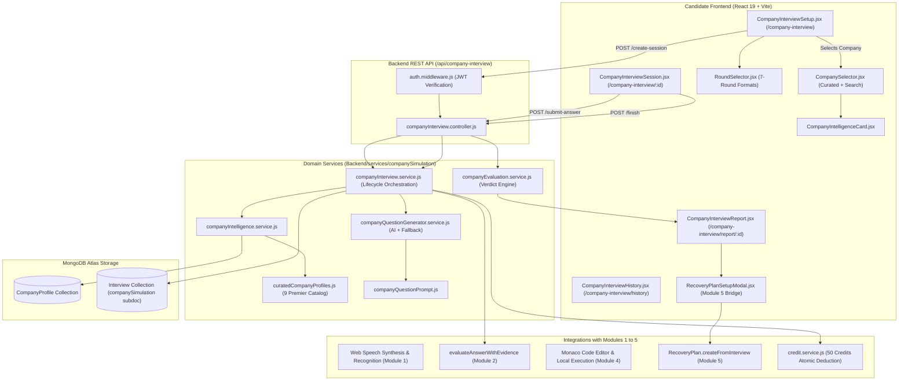

# Module 6: Company-Specific Interview Simulation Engine
## Master Technical Architecture & Specification

---

## 1. Executive Summary & Objective

**Module 6: Company-Specific Interview Simulation** transforms Prepper AI from a generic technical interview preparation tool into an authentic corporate hiring simulator. It enables candidates to prepare for technical screenings, system design reviews, coding assessments, and behavioral interrogations tailored to specific target companies (such as **Google, Microsoft, Amazon, Adobe, IBM, TCS, Infosys, Accenture, Deloitte**, and any candidate-supplied custom enterprise).

### Core Differentiators
1. **Publicly Documented Expectation Modeling**: Interviews replicate company-specific engineering standards (e.g. Amazon Leadership Principles, Google L4/L5 scalability rigor, Microsoft distributed cloud architecture) without claiming unauthorized access to proprietary corporate question banks.
2. **7-Round Simulation Architecture**: Supports Online Assessment (OA), Technical Round 1, Technical Round 2, System Design, Hiring Manager, Behavioral & Leadership, and Final HR.
3. **Role Readiness Scorecard**: Computes a normalized **Readiness Score (0–100)**, an explicit **Hiring Verdict** (`Strong Hire`, `Hire`, `Leaning Hire`, `Leaning No Hire`, `No Hire`), and an engineering **Fit Level** (`Exceeds Expectations`, `Meets Expectations`, `Needs Further Preparation`).
4. **Seamless Cross-Module Synergy**: Integrates Web Speech voice interaction (Module 1), multi-dimensional evidence scoring (Module 2), Monaco live coding workspace for coding assessments (Module 4), and one-click bridge to **Personalized Recovery Plans (Module 5)** to remediate detected company-specific preparation gaps.
5. **₹0 Infrastructure Overhead**: Built entirely on existing Node.js/Express, MongoDB Atlas, React 19, and OpenRouter AI integrations.

---

## 2. High-Level System Architecture



---

## 3. Data Models & Schemas

### 3.1 CompanyProfile Schema (`companyProfile.model.js`)
Persists public corporate interview intelligence, culture rubrics, and recommended interview structures.

```javascript
{
  name: { type: String, required: true, trim: true, unique: true },
  slug: { type: String, required: true, trim: true, lowercase: true, unique: true },
  industry: { type: String, default: 'Technology' },
  tier: { type: String, enum: ['Tier 1 Product', 'Tier 2 Product', 'IT Services & Consulting', 'FinTech', 'Startup', 'Enterprise Tech'], default: 'Tier 1 Product' },
  description: { type: String, default: '' },
  interviewCulture: { type: String, default: '' },
  supportedRounds: [{
    roundId: { type: String, required: true },
    name: { type: String, required: true },
    format: { type: String, enum: ['coding', 'system_design', 'behavioral', 'conceptual'], default: 'conceptual' },
    typicalQuestionCount: { type: Number, default: 4 },
    recommendedDuration: { type: Number, default: 45 },
    focusAreas: [{ type: String }],
  }],
  commonCompetencies: [{ type: String }],
  techStackFocus: [{ type: String }],
  behavioralPrinciples: [{ type: String }],
  disclaimer: { type: String },
  isVerified: { type: Boolean, default: false },
  createdBy: { type: mongoose.Schema.Types.ObjectId, ref: 'User', default: null }
}
```

### 3.2 Interview Schema Extension (`companySimulation` subdocument)
Seamlessly extends the existing `Interview` model rather than introducing disconnected tables:

```javascript
companySimulation: {
  isCompanySimulation: { type: Boolean, default: false },
  companyId: { type: mongoose.Schema.Types.ObjectId, ref: 'CompanyProfile', default: null },
  companyName: { type: String, default: null },
  companyTier: { type: String, default: null },
  interviewRound: { type: String, default: 'technical_round_1' },
  roundTitle: { type: String, default: 'Technical Round 1' },
  jobCategory: { type: String, default: 'Fullstack' },
  targetDesignation: { type: String, default: 'Software Engineer' },
  requiredSkills: [{ type: String }],
  jobDescription: { type: String, default: '' },
  companyPreparationNotes: { type: String, default: '' },
  readinessAssessment: {
    readinessScore: { type: Number, default: 0 },
    hireVerdict: { type: String, enum: ['Strong Hire', 'Hire', 'Leaning Hire', 'Leaning No Hire', 'No Hire'], default: 'Hire' },
    fitLevel: { type: String, enum: ['Exceeds Expectations', 'Meets Expectations', 'Needs Further Preparation'], default: 'Meets Expectations' },
    strengths: [{ type: String }],
    gaps: [{ type: String }],
    cultureFitAssessment: { type: String, default: '' },
    nextRoundRecommendation: { type: String, default: '' },
    evaluatedAt: { type: Date, default: null }
  }
}
```

---

## 4. The 7-Round Simulation Architecture

| Round ID | Round Title | Format | Duration | Question Focus | Primary Companies |
| :--- | :--- | :--- | :--- | :--- | :--- |
| `online_assessment` | Online Assessment (OA) | Coding / Problem Solving | 60 mins | LeetCode Medium/Hard, Edge Cases, Bit Manipulation, String Parsing | Google, Amazon, Microsoft, Adobe |
| `technical_round_1` | Technical Round 1 | Data Structures & Algorithms | 45 mins | Algorithmic Complexity, Trees, Graphs, Dynamic Programming | All Tier 1 & 2 Companies |
| `technical_round_2` | Technical Round 2 | Domain Architecture & Deep-Dive | 45 mins | Concurrency, Memory Models, API Contracts, Distributed Caching | Google, Microsoft, Adobe, FinTech |
| `system_design` | System Design Round | Scalability & Distributed Systems | 60 mins | High Availability, Partitioning, CAP Theorem, CDN, DB Sharding | L5+ Google, SDE II+ Amazon, Microsoft |
| `hiring_manager` | Hiring Manager Round | Engineering Leadership & Ownership | 45 mins | Architecture Trade-offs, Past Failures, Cross-Functional Impact | Amazon, Google, Startups |
| `behavioral` | Behavioral & Leadership | Culture & Value Alignment | 45 mins | STAR Method, Amazon 16 Leadership Principles, Googleyness | Amazon, Google, Deloitte, Accenture |
| `final_hr` | Final HR & Fit Round | Career Trajectory & Culture | 30 mins | Team Alignment, Compensation Expectations, Conflict Resolution | TCS, Infosys, Enterprise Tech |

---

## 5. Curated Intelligence & Dynamic Fallback Engine

Prepper AI comes pre-loaded with verified public engineering standards for 9 premier global companies:
1. **Google**: Focuses on algorithmic optimal Big-O complexity, distributed scalability, clean code abstractions, and "Googleyness".
2. **Amazon**: Rigorous testing against the 16 Leadership Principles (Customer Obsession, Ownership, Bias for Action, Dive Deep, Have Backbone; Disagree and Commit), and operational excellence.
3. **Microsoft**: Emphasis on enterprise cloud scale (Azure), modular software architecture, maintainability, and collaborative growth mindset.
4. **Adobe**: Multimedia performance, creative cloud microservices, reactive frontend state, and high-throughput rendering.
5. **IBM**: Hybrid cloud architecture, Red Hat OpenShift patterns, distributed systems resilience, and enterprise AI.
6. **TCS**: Core software engineering fundamentals, full-stack enterprise Java/Spring/.NET, relational databases, and testing.
7. **Infosys**: Strong object-oriented design, clean code refactoring, enterprise delivery pipelines, and cloud migrations.
8. **Accenture**: Cloud migration frameworks, modern architecture patterns, agile teamwork, and client-facing communication.
9. **Deloitte**: Technology modernization, risk-resilient architecture, data governance, and strategic solution design.

### Dynamic Intelligence Synthesis & Fallback
When a candidate enters an uncurated company (e.g. *Uber*, *Netflix*, *Stripe*, or a local tech startup):
1. **AI Synthesis**: Generates targeted engineering expectations, round structures, and tech stacks using OpenRouter LLM.
2. **Automatic DB Caching**: Caches the synthesized profile in MongoDB Atlas under the `CompanyProfile` collection for instantaneous reuse.
3. **Deterministic Fallback Bank**: If the AI provider is offline or times out, the system generates a safe, deterministic profile with complete 7-round coverage and verified engineering rubrics.

---

## 6. Role Readiness Scorecard & Hiring Verdict Calibration

The evaluation engine (`companyEvaluation.service.js`) analyzes candidate performance across:
$$\text{Readiness Score} = \sum_{i=1}^{N} \frac{\text{Score}_i}{N}$$

### Hiring Verdict Thresholds:
- **Strong Hire ($\ge 85$)**: Candidate demonstrates exceptional depth, optimal time/space complexity, proactive edge-case handling, and stellar culture alignment.
- **Hire ($70 - 84$)**: Candidate satisfies all primary competencies, produces correct architectures/code with minor guidance, and demonstrates good communication.
- **Leaning Hire ($60 - 69$)**: Demonstrates solid fundamentals with minor conceptual ambiguities or suboptimal secondary trade-offs.
- **Leaning No Hire ($45 - 59$)**: Demonstrates noticeable algorithmic or architectural inconsistencies relative to senior company standards.
- **No Hire ($< 45$)**: Exhibits critical misconceptions or fails core engineering rubrics.

---

## 7. Module 5 Recovery Plan Bridge

On the **Company Interview Report** page (`/company-interview/report/:id`) and **History** page (`/company-interview/history`):
- Candidates can click **"Generate Recovery Plan (Module 5)"** with zero manual configuration.
- The system passes the company interview session ID, target designation, and detected weak competencies into Module 5's `RecoveryPlanSetupModal`.
- Generates an adaptive, multi-day learning roadmap grounded in the exact company weaknesses uncovered during the simulation.

---

## 8. Credit Economics & Security Verification

1. **Credit Cost**: Standard 50 credits per simulation, identical to standard mock interviews (`INTERVIEW_CREDIT_COST`).
2. **Atomic Verification**: Insufficient credits ($< 50$) trigger HTTP 400 with immediate redirect to the pricing store.
3. **Automatic Refund Safeguard**: If interview document creation fails after credit deduction, `refundInterviewCredits` is automatically invoked.
4. **Anti-IDOR Ownership Protection**: Every endpoint (`GET /session/:id`, `POST /submit-answer`, `POST /finish`) validates `interview.userId.toString() === req.userId.toString()`. Unauthorized access returns HTTP 403 Forbidden.

---

## 9. REST API Endpoint Reference

| Method | Endpoint | Auth | Purpose |
| :--- | :--- | :--- | :--- |
| `GET` | `/api/company-interview/companies` | Optional | Retrieve curated and cached company profiles |
| `GET` | `/api/company-interview/companies/:slug` | Optional | Retrieve single company intelligence profile |
| `POST` | `/api/company-interview/intelligence` | Required | Synthesize on-demand company intelligence |
| `POST` | `/api/company-interview/recommend-structure` | Optional | Recommend interview round based on role & seniority |
| `POST` | `/api/company-interview/create-session` | Required | Deduct 50 credits and initialize company simulation |
| `GET` | `/api/company-interview/session/:id` | Required | Retrieve session state with anti-IDOR check |
| `POST` | `/api/company-interview/submit-answer` | Required | Submit candidate response and evaluate against rubrics |
| `POST` | `/api/company-interview/finish` | Required | Finalize simulation and compute Readiness Scorecard |
| `GET` | `/api/company-interview/history` | Required | Retrieve user's historical company simulations |

---

## 10. End-to-End Master Integration Verification & Test Coverage

An exhaustive end-to-end integration audit was conducted and codified in `Backend/tests/companyInterviewIntegration.e2e.test.js` to verify real cross-module synergy with Modules 1 through 5:

1. **Module 1 (Standard Interview Lifecycle)**: Verified session creation with status `Incompleted`, question array mapping, voice interaction support, answer recording, current question pointer advancement, and finalization to status `Completed`.
2. **Module 2 (Evidence-Based Rubric Scoring)**: Verified that company interview answers are evaluated via `evidenceEvaluation.service.js`, computing `overallScore`, normalized scores ($0-100$), multi-criteria breakdowns (`Technical Accuracy`, `Communication Clarity`), and attaching structured `evidenceEvaluation` to each question.
3. **Module 3 (Adaptive Difficulty & Steering)**: Verified that strong answer streaks increment `consecutiveStrongAnswers` and elevate question difficulty from `intermediate` to `advanced`, injecting contextual transition banners.
4. **Module 4 (Live Coding for Online Assessments)**: Verified that Online Assessment rounds populate `interview.codingProblems` with executable test cases and starter code, displaying a live Monaco Editor coding workspace CTA banner.
5. **Module 5 (Personalized Recovery Plan Harvesting)**: Verified that `evidenceHarvester.service.js` harvests company interview gaps and strengths (`sourceType: 'company_interview'`), bridging directly into targeted multi-day remediation roadmaps.
6. **Financial Integrity & Credit Safety**: Verified atomic 50-credit check, deduction on session creation, and automatic refund rollback if session persistence throws.
7. **Security & Anti-IDOR Protection**: Verified strict user ownership validation across all session retrieval, answer submission, and finalization endpoints.

### Verification Matrix:
- `Backend/tests/companyInterviewIntegration.e2e.test.js`: **11 / 11 passing**
- `Backend/tests/companyInterview.test.js`: **8 / 8 passing**
- `Frontend/tests/companyInterviewFrontend.test.js`: **15 / 15 passing**
- **Total Platform Automated Tests**: **338 / 338 passing**
