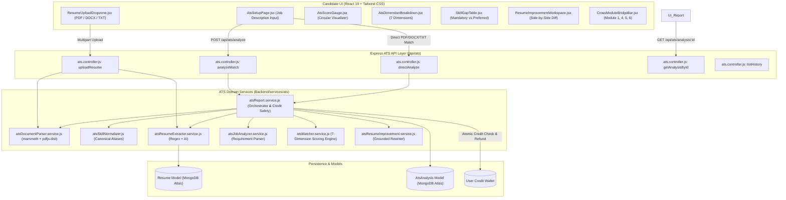
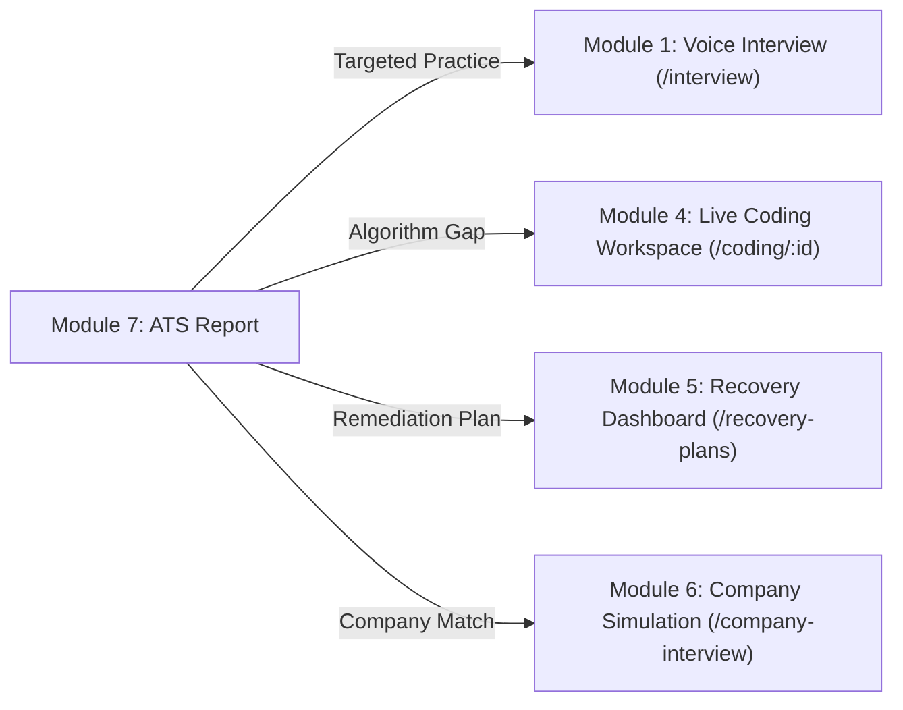

# Module 7: AI Resume-to-Job ATS & Application Intelligence
## Architectural Specification, Engineering Standard & Verification Matrix

---

## 1. Executive Summary & Purpose

**Module 7: AI Resume-to-Job ATS & Application Intelligence** is an enterprise-grade, privacy-focused, zero-cost intelligence subsystem engineered for Prepper AI. It equips software engineering candidates with deep, explainable insights into how applicant tracking systems (ATS) and technical hiring screeners evaluate resumes against specific job descriptions (JDs).

Rather than producing arbitrary "black-box" scores, Module 7 delivers:
1. **Multi-Format Parsing**: Secure, zero-cost local parsing for PDF (via `pdfjs-dist`), Word DOCX (via `mammoth`), and plaintext (`.txt`) documents up to 10MB.
2. **Canonical Skill Normalization**: Comprehensive alias mapping, variant resolution, and token deduplication to avoid false rejections (e.g. mapping `reactjs` $\rightarrow$ `React`, `k8s` $\rightarrow$ `Kubernetes`).
3. **Explainable 7-Dimension Matching**: Weighted scoring strictly totaling 100% across Required Skills (30%), Experience (20%), Projects (15%), Preferred Skills (10%), Responsibilities (10%), Keywords (10%), and Education (5%).
4. **Prioritized Skill Gap Breakdown**: Categorization of missing proficiencies into `mandatory` vs `preferred`, cross-referenced with practical remediation steps.
5. **Grounded Non-Hallucinating Improvement Engine**: Context-preserving rewrites of summaries, bullet points, and project descriptions enforcing strict non-hallucination rules (using explicit `[X]%` metric placeholders instead of fabricated numbers).
6. **Cross-Module Bridges**: One-click launches into Module 1 (Conversational Interview), Module 4 (Live Coding Assessment), Module 5 (Personalized Recovery Plan), and Module 6 (Company-Specific Simulation).
7. **Credit Safety**: Free document parsing (0 credits) and atomic 10-credit matching deduction with guaranteed refund rollback on failure.

---

## 2. High-Level Subsystem Architecture



---

## 3. The 7-Dimension ATS Scoring Engine

The scoring engine operates on an explainable, deterministic mathematical model. It guarantees that the overall match score is an exact weighted sum of seven independently calibrated criteria:

$$\text{Overall ATS Match Score} = \sum_{i=1}^{7} w_i \times S_i$$

### Dimension Weights and Calculation Criteria

| Dimension | Weight ($w_i$) | Evaluation Logic | Target Objective |
| :--- | :---: | :--- | :--- |
| **Required Skills** | **30%** | Normalized ratio of candidate's verified skills against all mandatory job requirements ($E_{\text{req}} / N_{\text{req}}$). | Verifies core technical baseline. |
| **Experience Depth** | **20%** | Compares candidate's total years of relevant experience against minimum required years (linear scale capped at 100). | Assesses seniority and career duration. |
| **Project Relevance** | **15%** | Evaluates overlap between project tech stacks, complexity, and target job domain. | Verifies tangible hands-on execution. |
| **Preferred Skills** | **10%** | Normalized ratio of nice-to-have or preferred technologies matched ($E_{\text{pref}} / N_{\text{pref}}$). | Bonus qualification differentiation. |
| **Responsibilities Alignment**| **10%** | Semantic and keyword alignment between candidate's past work duties and target role duties. | Assesses day-to-day role congruence. |
| **ATS Keyword Coverage** | **10%** | Frequency and distribution of high-value industry keywords across resume sections. | Passes algorithmic ATS parser filters. |
| **Education & Certifications**| **5%** | Degree level, field relevance (e.g. Computer Science, STEM), and industry certifications. | Validates academic or foundational credentials. |
| **Total Weight** | **100%** | **Rigorous, zero-deviation explainable composite score.** | **Definitive Match Indicator** |

### Score Categories & Transparency Disclaimer
- **90 – 100**: Exceptional Match (`High probability of screening advancement`)
- **75 – 89**: Strong Match (`Competitive candidate with minor skill or keyword gaps`)
- **60 – 74**: Moderate Match (`Meets foundational requirements; requires targeted optimization`)
- **40 – 59**: Weak Match (`Significant mandatory skill or experience deficiencies`)
- **0 – 39**: Low Match (`Unaligned experience profile; pivot or upskilling recommended`)

> **ATS Transparency Notice**: Prepper AI's ATS score provides an explainable estimation of technical alignment. Actual employer screening involves subjective recruiter judgment, team preferences, and dynamic candidate pools; no software can guarantee an interview callback.

---

## 4. Multi-Format Parsing & Security Hardening

To ensure complete privacy and zero vendor lock-in, document parsing executes locally without external third-party parsing APIs.

1. **PDF Documents**: Handled via `pdfjs-dist` text layer extraction.
2. **Word Documents (`.docx`)**: Handled via `mammoth.extractRawText({ buffer })` directly in memory.
3. **Plaintext (`.txt`)**: Handled via UTF-8 string decoding.
4. **Security Mitigations**:
   - **Path Traversal Protection**: Filenames are aggressively sanitized with regex `replace(/[^a-zA-Z0-9._-]/g, '_')`.
   - **Payload Limits**: Max file size is capped at 10MB (HTTP 413 on breach).
   - **File Magic Validation**: Rejects unsupported MIME types (`.exe`, `.sh`, `.zip`, `.js`).
   - **SHA-256 Hashing**: Generates unique content hashes to identify identical resumes and prevent duplicate processing.

---

## 5. Non-Hallucinating Resume Improvement Engine

Unlike generic generative AI tools that hallucinate unearned metrics, fake achievements, or nonexistent employers, Module 7 enforces strict **Grounded Non-Hallucination Guarantees**:

1. **Explicit Metric Placeholders**: When rewrites suggest quantifiable impact, they insert explicit brackets (e.g. `improved database query latency by [X]% across [Y] endpoints`) rather than fabricating numbers.
2. **Strong Action Verbs**: Rewrites lead with authoritative technical verbs (`Architected`, `Spearheaded`, `Refactored`, `Orchestrated`, `Implemented`, `Optimized`).
3. **STAR Method Alignment**: Bullets are re-structured into **Situation/Task $\rightarrow$ Action $\rightarrow$ Result**.
4. **Copy & Diff Workspace**: The frontend provides a side-by-side comparison tab allowing candidates to review and selectively copy changes to their clipboard.

---

## 6. Cross-Module Bridges

Module 7 serves as the launchpad into the rest of Prepper AI:



1. **Bridge to Module 1 (Voice Interview)**: Pre-fills role, experience level, and top identified skill gaps for a realistic technical interrogation.
2. **Bridge to Module 4 (Live Coding)**: Generates or redirects to algorithmic challenges focused on the candidate's missing technical competencies.
3. **Bridge to Module 5 (Recovery Plan)**: Feeds identified ATS weaknesses directly into a structured 7, 14, or 30-day study roadmap.
4. **Bridge to Module 6 (Company Simulation)**: Pre-configures a company simulation using the company name and job requirements extracted from the target JD.

---

## 7. Credit Economics & Financial Safeguards

- **Document Upload & Parsing**: `0 Credits` (Free inspection and parsing).
- **ATS Match Analysis**: `10 Credits` (Includes 7-dimension scoring, gap matrix, bullet rewrites, and persistent scorecard).
- **Atomic Deduction & Refund Rollback**:
  ```javascript
  const user = await User.findOneAndUpdate(
    { _id: userId, credits: { $gte: 10 } },
    { $inc: { credits: -10 } },
    { new: true }
  );
  if (!user) throw new AppError("Insufficient credits. 10 credits required.", 402);

  try {
    const analysis = await atsReportService.generateAnalysis(...);
    return analysis;
  } catch (err) {
    // Automatic compensation rollback
    await User.findByIdAndUpdate(userId, { $inc: { credits: 10 } });
    throw err;
  }
  ```

---

## 8. Anti-IDOR & Authorization Security

Every ATS endpoint enforces candidate ownership validation:
- Candidates can only view, download, or delete their own resumes and analysis reports (`userId.toString() === req.user._id.toString()`).
- Direct access attempts to another user's `analysisId` or `resumeId` fail immediately with `HTTP 403 Forbidden` or `HTTP 404 Not Found`.

---

## 9. Comprehensive Automated Test Matrix

Module 7 includes comprehensive unit, integration, and frontend regression test suites:

| Suite | File | Tests | Status | Key Validations |
| :--- | :--- | :---: | :---: | :--- |
| **Backend ATS Unit & Security** | `Backend/tests/atsIntelligence.test.js` | **15** | `PASSED` | Path traversal defense, canonical aliases, 7-dimension weighting, credit rollback, anti-IDOR security. |
| **Frontend Component & Integration** | `Frontend/tests/atsIntelligenceFrontend.test.js` | **11** | `PASSED` | Dropzone validation, gauge thresholds, 7-dimension cards, mandatory/preferred badges, diff tabs, navbar links. |
| **Company E2E Cross-Module Suite** | `Backend/tests/companyInterviewIntegration.e2e.test.js` | **11** | `PASSED` | Modules 1–6 cross-module integrity, credit verification, anti-IDOR safeguards. |
| **Recovery Plan Suite** | `Backend/tests/recoveryPlan.test.js` | **8** | `PASSED` | Evidence harvesting, task progression, reassessment scoring deltas. |
| **Frontend Full Regression** | `npm --prefix Frontend test` | **226** | `PASSED` | All 10 frontend suites across Modules 1–7 passing without failure. |
| **Production Vite Bundler** | `npm --prefix Frontend run build` | **1230 modules** | `PASSED` | Minified production bundles built with 0 errors. |
